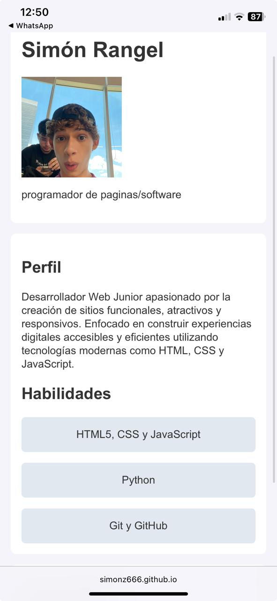
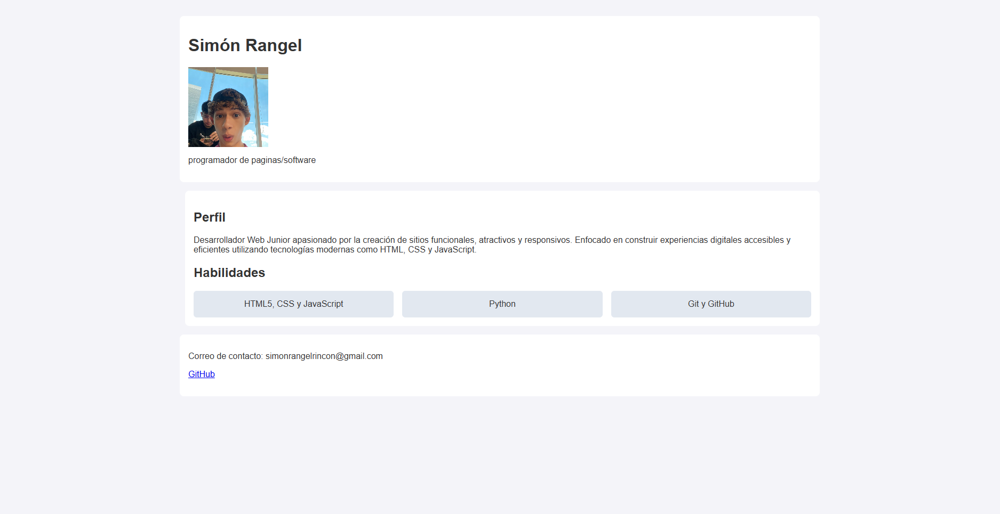

Hoja de vida web - Simón Rangel

Sitio web personal que incluye mi hoja de vida profesional, perfil, habilidades y medios de contacto.

Enlace del sitio publicado
* Sitio web en vivo: (https://simonz666.github.io/Hoja-de-vida/)

Páginas del proyecto
* index.html: Hoja de vida principal con mis datos profesionales, foto y sección de habilidades.

Lenguaje de programacion
* HTML5 (Estructura semántica)[cite: 3]
* CSS3 (Grid, Media Queries, unidades relativas como `rem`)[cite: 3]

Mockups (Fase de diseño)
* Los bocetos iniciales realizados antes de programar de este repositorio. 

Capturas del sitio publicado 
* Las capturas de pantalla de cómo se ve el proyecto en dispositivos móviles y computadores.  

Breakpoints implementados
* Diseño base (Celulares): Estructura en una sola columna con adaptación fluida[cite: 3].
* Pantallas grandes (Desde 1024px): Se utiliza grid-template-areas para organizar el diseño en columnas (menú/perfil y contenido principal).

Cómo se publicó el sitio
1. Se subieron todos los archivos del proyecto (`index.html`, `styles.css` y la carpeta `img`) a un repositorio público en GitHub.
2. Se activó la opción de GitHub Pages desde la pestaña *Settings* seleccionando la rama `main`.
